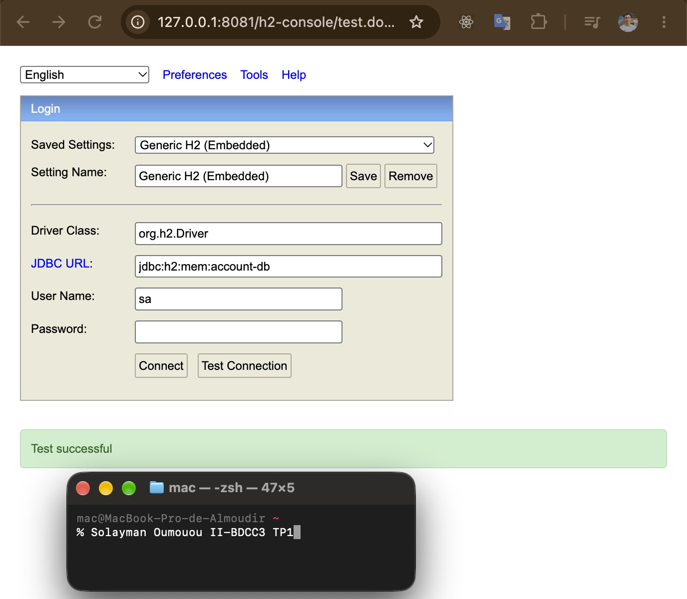
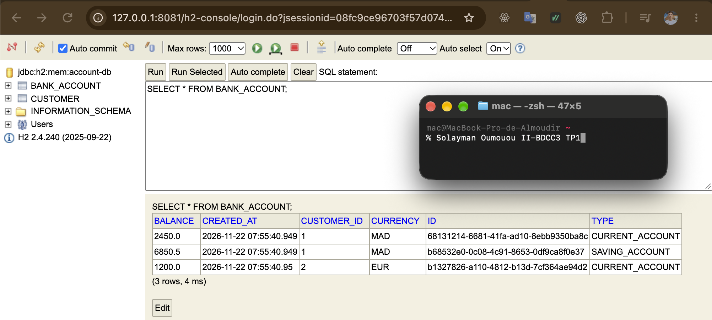
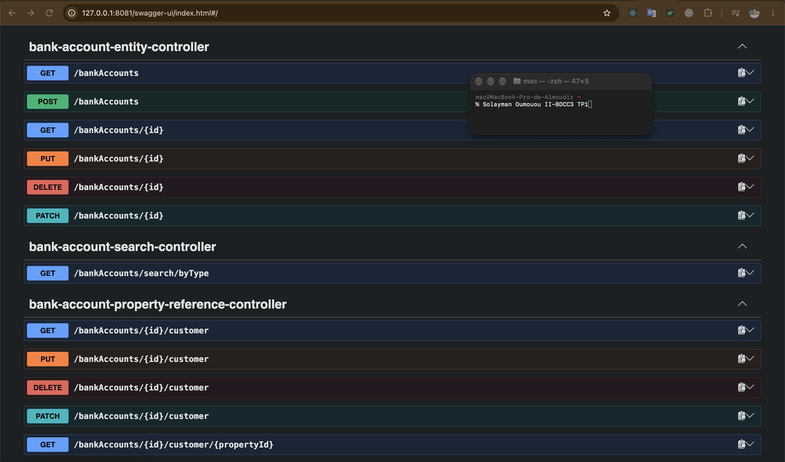
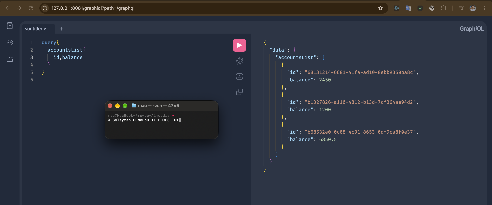
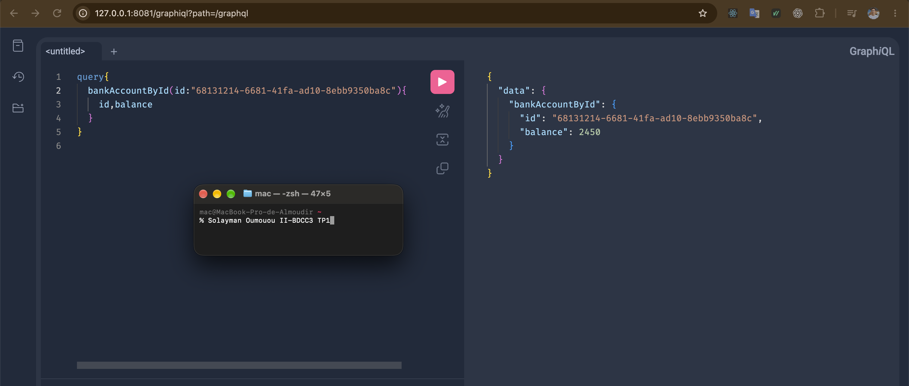
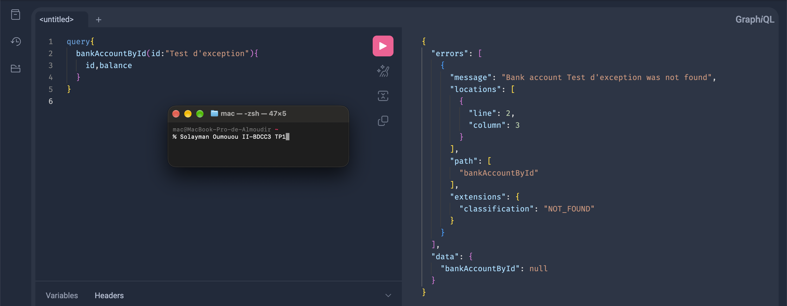

# Activité pratique 1 — Bank Account Service

**Solayman Oumouou · II-BDCC3**

Ce microservice Spring Boot permet de gérer des comptes bancaires et de consulter leurs titulaires. Il utilise Spring Data JPA avec une base H2 en mémoire et expose les données via REST, Spring Data REST et GraphQL.

## Démarrage

Depuis la racine du projet, lancez le service avec Java 17 ou une version ultérieure.

```bash
./mvnw spring-boot:run
```

Le service écoute sur le port `8081`. Au démarrage, la base H2 est initialisée avec trois comptes et deux clients. Pour exécuter le test de persistance, lancez `./mvnw test`.

## Persistance avec Spring Data JPA et H2

Dans la console H2, utilisez l’URL JDBC `jdbc:h2:mem:account-db`, l’utilisateur `sa` et laissez le mot de passe vide. [Console H2](http://localhost:8081/h2-console/)



La requête suivante affiche les trois comptes de démonstration et la colonne `CUSTOMER_ID` qui relie chaque compte à son titulaire.

```sql
SELECT * FROM BANK_ACCOUNT;
```



## API REST et Swagger

Le contrôleur REST utilise la couche métier, les DTO et le mapper pour gérer les comptes sous `/api/bankAccounts`.

| Méthode | Route | Opération |
| --- | --- | --- |
| `GET` | `/api/bankAccounts` | Lister les comptes |
| `GET` | `/api/bankAccounts/{id}` | Consulter un compte |
| `POST` | `/api/bankAccounts` | Créer un compte |
| `PUT` | `/api/bankAccounts/{id}` | Modifier les champs fournis |
| `DELETE` | `/api/bankAccounts/{id}` | Supprimer un compte |

Spring Data REST expose également le dépôt bancaire au format HAL. La projection `p1` sélectionne l’identifiant et le type du compte, tandis que la recherche `byType` filtre les comptes par type.

| Route | Résultat |
| --- | --- |
| `GET /bankAccounts` | Collection HAL des comptes |
| `GET /bankAccounts/{id}?projection=p1` | Identifiant et type du compte |
| `GET /bankAccounts/search/byType?t=SAVING_ACCOUNT` | Comptes d’épargne |

La capture montre les opérations générées par Spring Data REST, le filtre `byType` et les routes associées au titulaire du compte. [Swagger UI](http://localhost:8081/swagger-ui.html)



## API GraphQL

Le point d’accès GraphQL est `POST /graphql`. Les captures suivantes illustrent les requêtes exécutées dans l’interface GraphiQL. [GraphiQL](http://localhost:8081/graphiql)

### Lister les comptes

`accountsList` sélectionne ici seulement l’identifiant et le solde de chaque compte.

```graphql
query {
  accountsList {
    id
    balance
  }
}
```



### Consulter un compte par identifiant

Pour reproduire la requête, renseignez dans les variables un identifiant renvoyé par `accountsList`.

```graphql
query Compte($id: String) {
  bankAccountById(id: $id) {
    id
    balance
  }
}
```



### Gérer un compte introuvable

Avec un identifiant absent de la base, `bankAccountById` renvoie `null` et une erreur dont la classification est `NOT_FOUND`.



Le schéma permet aussi de consulter les comptes d’un client avec `customers`, de retrouver le titulaire d’un compte avec le champ `customer` et de gérer les comptes avec les mutations `addAccount`, `updateAccount` et `deleteAccount`. [Schéma GraphQL](src/main/resources/graphql/schema.graphqls)
